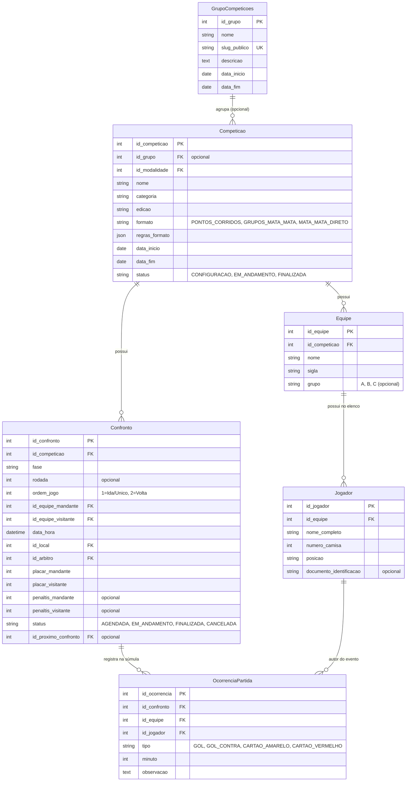

# Especificação Arquitetural do Domínio de Competições (V2)
**Data**: 14/09/2026  
**Status**: Em Revisão  
**Foco**: Competições de Futebol/Esportes Coletivos, Configuração Flexível de Torneios, Súmula Rápida de Beira de Campo e Portal Público Agrupador

---

## 1. Contexto, Problema e Motivação

### 1.1 Análise Crítica da V1
Na versão inicial (V1), foi modelada uma hierarquia rígida:
`Evento (Pai) ➔ Edição (Intermediária) ➔ Competição (Filho) ➔ Equipes/Partidas`

Ao testar o fluxo prático com o usuário, foram constatadas falhas conceituais e operacionais:
1. **Burocracia Excessiva**: Para organizar um torneio de futebol ou futsal, o organizador era obrigado a criar um Evento, depois criar uma Edição, e só então criar uma Competição.
2. **Confusão de Responsabilidades**: A tela de Edição perguntava regras esportivas (ex: se era mata-mata ou pontos corridos), enquanto uma edição deveria ser apenas uma marcação temporal (ano e datas). Além disso, telas legadas antigas tentavam cadastrar equipes na edição sem apontar para a competição, quebrando a integridade de dados.
3. **Desacoplamento Incorreto de Festivais e Olimpíadas**: Em eventos multiesportivos (ex: Olimpíadas Escolares), as competições de cada modalidade têm regras, formatos e tabelas completamente distintos. Forçar um evento pai a ditar regras antecipadamente não reflete a realidade esportiva.

### 1.2 A Mudança de Paradigma na V2
1. **Competição como Cidadão de Primeira Classe**: A `Competicao` é agora o elemento central e independente no sistema. O organizador acessa o menu, clica em "Nova Competição" e configura diretamente seu torneio.
2. **Configuração Dinâmica e Reativa**: A competição define suas regras específicas para Futebol/Futsal com parâmetros flexíveis (Pontos Corridos, Grupos + Mata-Mata, Mata-Mata Direto, jogos de Ida e Volta, pênaltis e disputa de 3º lugar).
3. **Equipes e Elencos Dedicados**: A equipe é cadastrada dentro da competição, e dentro da equipe são cadastrados os jogadores com seus números de camisa e posições.
4. **Súmula Rápida de Beira de Campo**: Registro em tempo real de gols (com artilheiros) e cartões (amarelos/vermelhos) durante a partida, atualizando instantaneamente o placar e as estatísticas.
5. **Evento/Olimpíada como Agrupador Opcional**: O `GrupoCompeticoes` (Evento) existe apenas como uma conveniência para agrupar competições independentes (ex: agrupar Futsal Sub-17 e Futebol Society sob *"Olimpíada Escolar 2026"*), gerando um **Portal Público Agrupador Unificado**.

---

## 2. Modelo de Dados e Esquema de Banco de Dados



### 2.1 Detalhamento de `regras_formato` (JSON Estruturado)
O campo `regras_formato` varia dinamicamente conforme o formato selecionado:

#### A. `PONTOS_CORRIDOS`
```json
{
  "turno_returno": true,
  "pontos_vitoria": 3,
  "pontos_empate": 1,
  "pontos_derrota": 0,
  "criterios_desempate": ["PONTOS", "VITORIAS", "SALDO_GOLS", "GOLS_PRO", "CONFRONTO_DIRETO", "MENOS_VERMELHOS"]
}
```

#### B. `GRUPOS_MATA_MATA`
```json
{
  "qtd_grupos": 2,
  "times_por_grupo": 4,
  "classificados_por_grupo": 2,
  "fase_grupos_ida_e_volta": false,
  "fase_inicial_mata_mata": "Semifinal",
  "mata_mata_ida_e_volta": true,
  "final_jogo_unico": true,
  "disputa_terceiro_lugar": true,
  "decisao_empate_mata_mata": "PENALTIS"
}
```

#### C. `MATA_MATA_DIRETO`
```json
{
  "fase_inicial": "Quartas",
  "ida_e_volta": false,
  "final_jogo_unico": true,
  "disputa_terceiro_lugar": false,
  "decisao_empate": "PENALTIS"
}
```

---

## 3. Regras de Negócio e Motores de Cálculo

### 3.1 Geração de Confrontos
- **Pontos Corridos**: Aplicação do algoritmo round-robin distribuindo mandos de campo equilibrados. Se `turno_returno=True`, gera a segunda metade da tabela com mandos invertidos.
- **Grupos**: Gera os confrontos isolados de cada grupo. O chaveamento da fase eliminatória é pré-vinculado via cruzamento olímpico clássico (ex: 1ºA x 2ºB e 1ºB x 2ºA).
- **Mata-Mata**: Gera as chaves com encadeamento `id_proximo_confronto`.
  - **Ida e Volta**: Gera par de jogos (`ordem_jogo=1` e `ordem_jogo=2`). A classificação é avaliada pela soma dos placares (`placar_mandante + placar_visitante` agregado). Empate no agregado após o jogo 2 ativa a disputa de pênaltis.
  - **Disputa de 3º Lugar**: Os perdedores das semifinais são automaticamente apontados para a disputa do bronze.
  - **Bloqueio Retroativo**: Finalizar uma semifinal promove o vencedor para a final. Caso a final já tenha sido iniciada ou finalizada, a reabertura ou alteração do resultado da semifinal é rejeitada com HTTP 422.

### 3.2 Súmula e Estatísticas em Tempo Real
- Registrar um evento `GOL` em `OcorrenciaPartida`:
  - Incrementa automaticamente o `placar_mandante` ou `placar_visitante` do confronto.
  - Atualiza o ranking geral de **Artilharia** da competição (`COUNT(gols)` por jogador).
- Registrar `CARTAO_AMARELO` ou `CARTAO_VERMELHO`:
  - Se um atleta receber 2 amarelos no mesmo confronto, o sistema gera o registro automático de cartão vermelho por segundo amarelo.
  - Alimenta o controle disciplinar: exibe alertas de atletas suspensos para o próximo confronto.

### 3.3 Classificação Dinâmica
- A tabela de classificação não é estática; ela é calculada dinamicamente a partir dos confrontos finalizados.
- Se for por grupos, as tabelas são particionadas e ordenadas pelos critérios de desempate configurados.

---

## 4. Arquitetura de Telas e Experiência do Usuário (Frontend)

### 4.1 Menu Lateral
- **🏆 Competições**: Entrada direta para a lista de campeonatos.
- **📁 Eventos / Festivais**: Área para criar grupos/olimpíadas e selecionar as competições associadas.
- **🏫 Escolinhas**: Turmas, Alunos e Matrículas mantidos em seu módulo próprio.

### 4.2 Lista de Competições (`/dashboard/competicoes`)
- Cards modernos com filtros por status e modalidade.
- Botão primário: **"+ Criar Nova Competição"**.

### 4.3 Formulário Dinâmico de Nova Competição
- **Etapa 1 - Dados Básicos**: Nome, Modalidade, Categoria, Edição/Ano, Período.
- **Etapa 2 - Formato Reativo**: Ao escolher o formato, os campos condicionais correspondentes aparecem na mesma tela de forma interativa.
- Ao salvar, navega direto para `/dashboard/competicoes/[id]`.

### 4.4 Painel Master da Competição (`/dashboard/competicoes/[id]`)
Organizado em 4 abas especializadas:
1. **Aba "Equipes e Elencos"**:
   - Botão **"+ Cadastrar Equipe"** (Nome, Sigla, Grupo).
   - Gaveta/Drawer ao clicar na equipe para gerenciar o elenco: **"+ Adicionar Jogador"** (Nome, Número da camisa, Posição, Documento).
2. **Aba "Jogos e Confrontos"**:
   - Botão **"Gerar Tabela de Jogos"** (distribui as equipes cadastradas nas rodadas/fases).
   - Botão **"+ Agendar Jogo Manual"**.
   - Cards dos jogos com atalho para a **Súmula Rápida**.
3. **Aba "Classificação e Chaveamento"**:
   - Tabela de pontos corridos / grupos com aproveitamento %.
   - Visualização da árvore eliminatória de mata-mata (com suporte a ida/volta e 3º lugar).
4. **Aba "Artilharia e Cartões"**:
   - Ranking dos maiores artilheiros da competição.
   - Lista de advertências e suspensões.

### 4.5 Modo Beira de Campo / Súmula Rápida da Partida
- Modal ou tela cheia otimizada para tablets e celulares:
  - Placar central grande com tempo de jogo.
  - Botões rápidos: `+ Gol Time A`, `+ Gol Time B` (seleciona o atleta em 1 toque).
  - Botões de cartões amarelo e vermelho.
  - Linha do tempo visual da partida.
  - Botão de encerramento de jogo (com registro de pênaltis caso termine empatado no mata-mata).

---

## 5. Portal Público Agrupador (`/publico/evento/[slug]`)

### 5.1 Visão Geral
- Página pública responsiva e limpa para torcedores, atletas e familiares acompanharem no celular.
- Acesso sem necessidade de autenticação.

### 5.2 Elementos da Página Agrupadora
1. **Header do Evento**: Banner, título (ex: *"Olimpíada Municipal 2026"*), datas e selo pulsante **"AO VIVO"** quando houver jogos ocorrendo.
2. **Abas de Modalidades/Competições**: Seletor horizontal com as competições vinculadas (ex: `[ Futebol Sub-17 ] [ Futsal Adulto ] [ Futebol Master ]`).
3. **Painel da Competição Selecionada**:
   - **Jogos**: Próximos confrontos agendados, jogos ao vivo e jogos encerrados com detalhes de quem marcou os gols.
   - **Classificação**: Tabelas completas e legíveis.
   - **Mata-Mata**: Árvore gráfica eliminatória com os caminhos até a final.
   - **Artilharia**: Ranking dos principais goleadores.
4. **Conformidade LGPD**: Filtragem total de documentos pessoais, endereços, telefones ou e-mails de atletas e árbitros.

---

## 6. Estratégia de Migração e Compatibilidade

1. **Schema Aditivo**:
   - Manter a tabela `competicoes`, adicionando o relacionamento opcional `id_grupo` (nullable) e o campo JSON `regras_formato`.
   - Adicionar tabela `grupos_competicoes` para a função de agrupador/evento.
   - Adicionar tabela `ocorrencias_partida` para os eventos de súmula rápida (gols e cartões).
   - Tabela `equipes` e `jogadores` já possuem suporte estrutural e passam a ser operadas no escopo exclusivo da competição.
2. **Preservação de Dados Existentes**:
   - Nenhuma exclusão destrutiva de dados do banco legado.
   - Migração progressiva das rotas do frontend sem quebrar o domínio de escolinhas.

---

## 7. Critérios de Sucesso e Validação

1. **Usabilidade**: Criação de um campeonato de futebol completo em menos de 2 minutos (Nome, regras, times, geração de confrontos).
2. **Súmula em Tempo Real**: Registro de gols e cartões na beira de campo refletido imediatamente no placar da partida, na tabela de classificação e na artilharia geral.
3. **Agrupamento Opcional**: Capacidade de criar 3 competições independentes e vinculá-las a um evento/olimpíada com página pública unificada.
4. **Qualidade de Código**:
   - 100% dos testes unitários e de integração passando.
   - Zero erros de typecheck no TypeScript (`npx tsc --noEmit`).
   - `npm run build` do Next.js aprovado.
   - `git diff --check` limpo.
