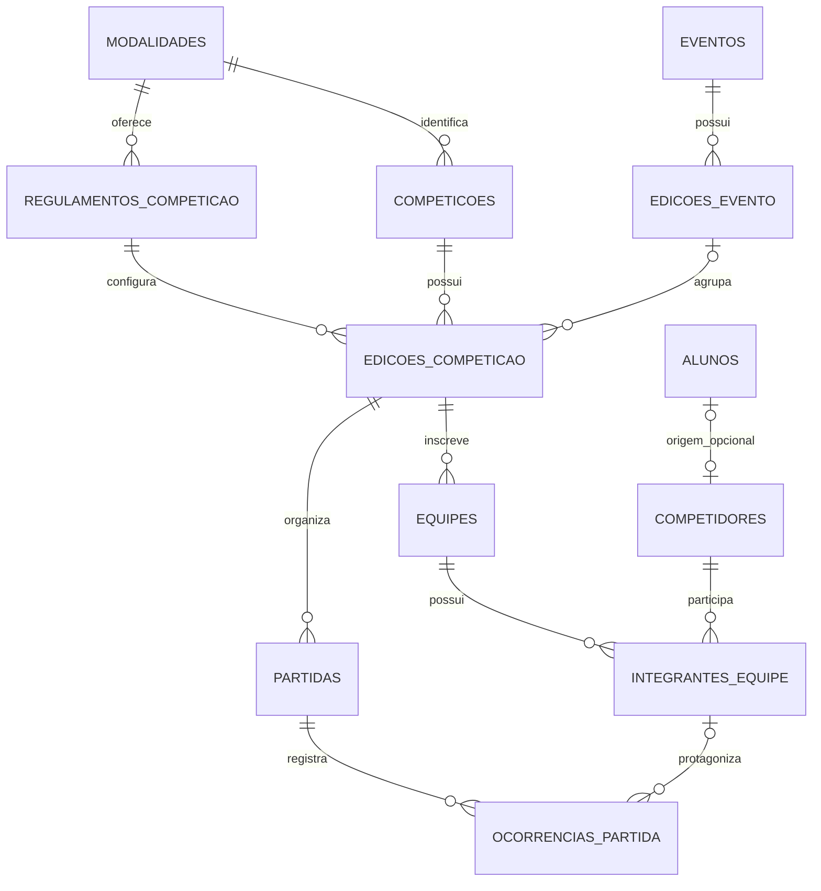

# Consolidação de competições e entrega de futebol

Data: 2026-09-28

Status: **SUPERSEDIDA em 2026-10-15** por
[Consolidação de competições em fatias entregáveis](2026-10-15-competicoes-fatias-design.md).
Nunca implementada. Mantida como referência histórica: a maior parte das decisões
de domínio aqui registradas segue valendo e foi reaproveitada na especificação
nova. O que mudou: entrega em fatias verticais em vez de corte coordenado único;
motor de regulamentos em JSON versionado retirado (futebol-only); cadeia Alembic
0001–0006 substituída por baseline novo; retirada do legado antecipada para a
primeira fatia de domínio; commits em branch permitidos.

Status original: aprovada pelo usuário em 2026-09-28; [plano de implementação
escrito para revisão](../plans/2026-09-28-consolidacao-competicoes-futebol.md);
implementação não iniciada.

Esta especificação reúne as decisões aprovadas na conversa e os detalhes técnicos
aprovados na revisão escrita. A skill `superpowers:writing-plans` produzirá o
plano de implementação. A execução
solicitada será por agentes com permissão de edição, paralelizando somente
trabalhos independentes e com responsáveis definidos por arquivo.

## 1. Objetivo e limites

Concluir a transição de competições para um único domínio consistente em banco,
backend e frontend. Entregar futebol, com campeonatos independentes ou integrados
a eventos, histórico por edição, regulamentos configuráveis, elencos, partidas,
súmula, classificação, disciplina e consulta pública.

Decisões confirmadas pelo usuário:

- Os dados atuais de competição são de teste e não precisam ser preservados.
- Esta entrega contempla somente futebol. Outras modalidades terão caminho de
  extensão documentado, sem motores ou telas operacionais nesta entrega.
- Todas as inscrições usam equipes, que podem representar uma pessoa. Remover
  `modo_inscricao`; isso não obriga formatos e resultados de esportes diferentes
  a funcionarem como uma partida de futebol.
- Evento e competição são cadastros permanentes com edições. A competição pode
  existir sem evento. A edição esportiva guarda as configurações e a disputa.
- Categoria é opcional; início e fim pertencem às edições.
- Competidores são independentes dos alunos, com importação opcional e sem
  sincronização automática. Elencos pertencem às equipes de cada edição.
- Equipes/elencos podem ser copiados de uma edição anterior, criando inscrições
  novas e reutilizando os competidores.
- Regulamentos versionados em JSON alimentam um formulário interativo. Cada
  edição salva suas próprias escolhas.
- Estados da edição: `RASCUNHO`, `EM_ANDAMENTO`, `FINALIZADA`, `CANCELADA`.
  Publicação é independente do estado esportivo.
- Resultado simples e súmula detalhada convivem. Autoria de gol é opcional.
  A súmula é a visão da partida e das ocorrências; não há tabela `sumulas`.
- Correções respeitam dependências esportivas e registram responsável, data e
  motivo. Disciplina gera alertas e acompanhamento, sem punição administrativa
  automática nem bloqueio do registro do que aconteceu em campo.
- Formatos: pontos corridos, grupos + mata-mata e mata-mata direto. Admitir
  folgas, classificação automática e geração sem agendamento completo.
- Empates eliminatórios são decididos por pênaltis, sem prorrogação nem gol fora.

Restrições de execução preservadas do projeto:

- Não criar commits Git nesta implementação; manter alterações revisáveis.
- Não alterar `.env` nem executar testes contra banco de desenvolvimento ou produção.
- Preservar usuários, autenticação, professores, modalidades, locais, árbitros,
  alunos, turmas, matrículas e presenças.
- Descarte de dados de competição não autoriza reset do banco inteiro. A limpeza
  será delimitada e aplicada ao ambiente-alvo somente na etapa de implantação.
- Não implantar nem executar limpeza no banco conectado durante o planejamento.

Fora do escopo: modalidades além de futebol, editor administrativo de JSON,
fórmulas arbitrárias de regulamento, inscrição externa autônoma, transferências
entre equipes da mesma edição, cobrança, súmula assinada/homologação documental,
W.O. automático, desclassificação automática e WebSocket.

## 2. Base atual e o que aproveitar

O workspace contém SQLAlchemy, Pydantic, Alembic e módulos V1/V2 ativos ao mesmo
tempo. `competicoes` ainda mistura identidade, edição e configuração; coexistem
`partidas` e `confrontos`, `equipes_participantes` e `jogadores`, além de eventos,
edições e grupos agregadores.

Reaproveitar, mediante testes do contrato novo:

- Algoritmos de `app/services/confrontos_v2.py`, `classificacao_v2.py` e partes de
  `sumula_v2.py`; não conservar aliases de formato/chaves inconsistentes.
- Formulários e componentes de `frontend/src/components/competicoes-v2/`.
- Estrutura visual do painel, árvore, súmula móvel e portal público.
- Infraestrutura de migrações e fixtures isoladas, corrigindo a equivalência
  entre schema migrado e metadata ORM.

Comportamentos que precisam mudar:

- O formulário possui regras fixas no código e a API aceita `dict/Any` amplo.
- A criação/atualização V2 não centraliza as mesmas regras dos serviços antigos.
- O gerador atual escolhe local/árbitro e data/horário padrão; a nova geração não
  inventará agendamento para satisfazer colunas obrigatórias.
- O disciplinar atual conta cartões acumulados; a nova suspensão terá histórico
  de origem e cumprimento.
- A publicação atual deriva de não estar em rascunho; passará a ser explícita.
- Serviços de exclusão de alunos/atletas referenciam `equipes_participantes`.
  Retirar essas dependências junto com a tabela, preservando o restante do fluxo.

Evidência anterior: os mapeamentos ORM carregaram; em
`migration_tests/test_schema_migrations.py`, sete testes passaram e um falhou na
representação da unicidade de `grupos_competicoes.slug`. A execução ampla foi
interrompida pelo timeout. Não há certificação atual da suíte completa nem do
schema de um MySQL em execução. O checkpoint antigo não substitui nova validação.

## 3. Modelo de domínio e persistência



O diagrama mostra os vínculos principais. As entidades auxiliares de grupos,
chaveamento, auditoria e disciplina estão descritas abaixo.

### 3.1 Identidade, recorrência e inscrições

| Tabela | Dados e responsabilidade |
| --- | --- |
| `eventos` | Nome, descrição, slug único e arquivamento da identidade permanente. |
| `edicoes_evento` | FK do evento, identificação da edição, início e fim. Sem regras esportivas. |
| `competicoes` | Nome, descrição, slug único, FK da modalidade e arquivamento. Identidade permanente. |
| `edicoes_competicao` | FK da competição; FK opcional de edição do evento; identificação da edição; categoria opcional; datas; regulamento; configuração JSON; estado; visibilidade; controle de revisão. |
| `competidores` | Nome, nascimento/documento/foto opcionais, ativo e FK opcional única `id_aluno_origem`. Sem escola, responsáveis ou informações médicas. |
| `equipes` | FK obrigatória de edição da competição, nome, sigla opcional e situação. Nunca pertencem diretamente ao evento. |
| `integrantes_equipe` | Equipe, competidor, edição, camisa/posição opcionais, nome esportivo registrado naquela inscrição e situação. |

Restrições:

- Identificação da edição é única dentro de seu cadastro permanente, não
  globalmente. Aceitar rótulo como `2026` ou `2026 — segundo semestre`.
- Datas de início/fim são obrigatórias e ordenadas. Uma edição esportiva ligada
  ao evento deve caber no período da edição do evento. Alterar o período do
  evento valida os filhos; não muda suas datas silenciosamente.
- Regulamento deve corresponder à modalidade da competição. Não permitir mudar
  a modalidade de uma competição que já tenha edições; criar outro cadastro.
- Uma edição esportiva pertence a no máximo uma edição de evento. A edição do
  evento pode reunir competições diferentes sem duplicar a realização esportiva.
- Um competidor participa de no máximo uma equipe por edição. Materializar a
  unicidade `(id_edicao_competicao, id_competidor)` e uma FK composta que assegure
  que a equipe pertence àquela edição; não depender apenas de consulta prévia.
- Camisa não nula é única no elenco ativo da equipe, validada sob transação.
  Permitir ausência de camisa. Não usar nome/documento como chave de pessoa.
- Importar aluno exige acesso à escolinha e à gestão de competições. A operação
  reutiliza a origem única; não faz associação automática por semelhança de nome.
- Excluir aluno usa `SET NULL` no vínculo de origem, preservando o competidor.
  SQLAlchemy deve refletir essa política, sem `delete-orphan` nesse vínculo.
- Copiar equipes é operação explícita e atômica para edição em rascunho, ainda
  sem tabela gerada. Não copiar partidas, cartões, suspensões ou resultados.
- Alterações no cadastro do competidor não reescrevem o nome esportivo registrado
  no elenco histórico. Correções históricas explícitas ficam auditadas.
- Depois do início, permitir inativar integrantes para uso futuro, sem apagá-los
  nem invalidar ocorrências anteriores. Novas inscrições após o início ficam
  fora desta entrega. Terceiros e alunos importados seguem as mesmas regras.
- Equipes podem ser cadastradas vazias em rascunho, mas iniciar a edição exige
  pelo menos um integrante ativo por equipe. Esta aplicação não fiscaliza um
  número mínimo regulamentar de atletas em campo nesta entrega.

Não eliminar `participantes` ou sua ligação atual com alunos nesta entrega:
é infraestrutura compartilhada das escolinhas. O novo módulo não a utiliza.
`atletas` deixa de ser caminho de inscrição em competições; sua eventual retirada
integral é outro trabalho, não um requisito para eliminar os fluxos esportivos
duplicados. Retirar referências às tabelas esportivas removidas de seus serviços.

### 3.2 Regulamentos e configuração

`regulamentos_competicao` terá:

- `id_regulamento`, `id_modalidade`, `formato`, `tipo_resultado`, `versao`,
  `schema_configuracao`, `ativo`.
- Unicidade `(id_modalidade, formato, versao)`; apenas uma versão selecionável
  por modalidade/formato, coordenada na publicação do catálogo.
- Formatos desta entrega: `PONTOS_CORRIDOS`, `GRUPOS_MATA_MATA`, `MATA_MATA`.
  Tipo de resultado: `PLACAR`.
- Sem coluna `nome`: a apresentação usa rótulos dos códigos suportados.
- O JSON reúne definição e padrões dos campos. Metadados de apresentação têm
  namespace próprio, sem JavaScript, HTML executável ou expressões arbitrárias.

Arquivos fonte imutáveis por versão:

```text
app/regulamentos/futebol/pontos_corridos.v1.json
app/regulamentos/futebol/grupos_mata_mata.v1.json
app/regulamentos/futebol/mata_mata.v1.json
```

Publicar o catálogo por comando explícito idempotente, executado após a migração,
nunca no startup HTTP. Mesma chave e mesmo conteúdo: nenhuma alteração. Mesma
chave e conteúdo diferente: erro exigindo versão nova. Alterar disponibilidade
não altera o conteúdo da versão. As migrações históricas não importam arquivos
mutáveis nem o metadata atual para reconstruir DDL antigo.

Associar o catálogo ao registro correto de modalidade por mapeamento explícito
no comando de publicação; não depender de um ID fixo ou comparação frouxa de
nome. Nesta entrega, somente a modalidade mapeada para futebol recebe catálogo.

O frontend busca regulamentos por modalidade. A API só oferece combinações
suportadas pelo motor e com versão ativa. Criar modalidade nas escolinhas não
habilita automaticamente um esporte no módulo de competições.

O backend valida tipos, campos desconhecidos, limites, enums, listas ordenadas
sem repetição e combinações de negócio. Aplicar padrões explicitamente ao salvar
`edicoes_competicao.configuracao`; não depender de padrões variáveis na leitura.
Configuração e regulamento são obrigatórios na criação da primeira edição; o
rascunho permite alterar escolhas sem exigir equipes ou tabela completa.

O contrato do JSON tem um subconjunto documentado de campos suportados pelo
renderizador: booleanos, inteiros, seletores, listas ordenáveis, agrupamento,
ordem e visibilidade condicionada ao valor de outro campo. A validação de domínio
permanece no backend. Ocultar um campo não autoriza enviar uma opção incompatível.

Dados de partida, gols, sets ou tempos não pertencem ao JSON de regulamento.
Adicionar outra modalidade exigirá motor e estruturas de resultado adequados,
além do catálogo. Reutilizar identidade/edições/equipes/elencos; não obrigar uma
prova futura a caber em `partidas`. Não criar agora tabelas futuras vazias.

### 3.3 Grupos, eliminatórias e partidas

Modelo técnico proposto para revisão:

- `grupos_competicao`: grupos esportivos A/B/etc. de uma edição; distintos de
  eventos agregadores. `equipes.id_grupo` é opcional e sua FK composta com edição
  garante que equipe e grupo pertencem à mesma edição. Nome de grupo é único
  dentro da edição.
- `duelos_eliminatorios`: unidade que decide um classificado, com edição, fase,
  posição na chave, estado e vencedor. Um duelo tem um ou dois jogos. Uma
  classificação automática não cria partida nem placar.
- `vagas_duelo`: duas posições por duelo. Origem explícita: equipe inicial,
  posição de grupo, vencedor/perdedor de duelo anterior ou folga inicial. Guardar
  FKs e posição de classificação correspondentes; validar origem única e mesma
  edição. Não inferir destino pelo texto do nome da fase.
- `partidas`: edição, grupo opcional, duelo opcional, rodada/fase, ordem do jogo,
  mandante/visitante, data/hora/local/árbitro opcionais, estado e pênaltis opcionais.

Essas tabelas auxiliares tornam explícitas dependências para ida/volta, bronze,
folgas e correções. Elas não representam duas versões de partida.

Gerar partidas eliminatórias apenas quando houver dois adversários conhecidos;
a árvore mostra os duelos/vagas pendentes antes disso. Liga/grupos geram as
partidas com adversários conhecidos mesmo sem agendamento. Mandante e visitante
são distintos e pertencem à edição. Data/hora podem permanecer não informadas;
não criar local, árbitro ou horário fictício. Pênaltis têm valores inteiros não
negativos e diferentes, somente no jogo decisivo cujo placar/agregado empatou.

Estado interno da partida: `AGENDADA`, `EM_ANDAMENTO`, `FINALIZADA`, `CANCELADA`.
`AGENDADA` significa jogo ainda não iniciado, podendo ter agendamento pendente;
a interface distingue essa pendência. A edição precisa estar em andamento para
iniciar ou registrar resultado. Registrar o primeiro evento pode iniciar o jogo,
mas nunca iniciar a edição implicitamente.

## 4. Formatos e regras de futebol

### 4.1 Pontos corridos e grupos

- Liga usa round-robin; quantidade ímpar gera folgas sem jogos fictícios.
- Turno/returno inverte mandos. Grupos usam o mesmo cálculo, isolado por grupo.
- Pontos configuráveis por vitória/empate/derrota, inteiros não negativos;
  padrões propostos: 3/1/0. Pontos são a primeira ordenação obrigatória.
- Desempates suportados nesta entrega: vitórias, saldo de gols, gols pró,
  confronto direto, menos vermelhos e menos pontos disciplinares. Ordem editável.
- Confronto direto usa mini-tabela entre empatados, somente quando seus jogos
  relevantes estiverem finalizados; aplicar pontos, saldo e gols pró dentro dela.
- Empate persistente tem indicação explícita. Uma ordenação visual estável não
  constitui classificação esportiva. Decisão manual com motivo resolve a vaga
  ou o título, ficando vinculada ao conjunto empatado e à revisão dos resultados.
  Resultado alterado invalida a decisão afetada e exige conferência novamente.
- Grupos permitem distribuição automática equilibrada e ajuste manual antes de
  iniciar. Validar quantidade de grupos/equipes/classificados. Cada grupo precisa
  permitir a quantidade de classificados configurada.
- O cruzamento é materializado nas vagas e apresentado antes do início. Para
  dois grupos e dois classificados, usar 1ºA × 2ºB e 1ºB × 2ºA. Para outras
  quantidades, gerar proposta determinística por posição/grupo e permitir revisar
  os cruzamentos antes do início, validando que cada vaga aparece uma única vez.
- Encerrar a fase de grupos é explícito e exige jogos resolvidos e ausência de
  empates pendentes nas vagas. Só então preencher adversários das eliminatórias.

### 4.2 Eliminatórias

- Jogos únicos ou ida/volta; final pode ser única independentemente das rodadas
  anteriores. Ida/volta agrega gols por identidade da equipe, invertendo mandos.
- Empate decisivo exige pênaltis. Não usar gol fora nem prorrogação.
- Disputa de terceiro lugar opcional, alimentada pelos perdedores das semifinais.
  Oferecer somente quando houver duas semifinais disputadas; rejeitar combinação
  impossível na prévia da geração.
- Quantidade não potência de dois gera folgas distribuídas na primeira fase.
  Classificação automática é estado do duelo, não vitória por placar fictício.
- Classificação automática não produz gols, cartões, partida disputada, pontos
  de liga ou cumprimento de suspensão.
- Não oferecer escolha textual de fase inicial incompatível com a quantidade de
  equipes; calcular tamanho da chave a partir das inscrições e mostrar a prévia.

### 4.3 Configurações técnicas propostas

Os nomes das chaves serão únicos entre catálogo, API, motores e TypeScript.
Eliminar aliases antigos como `turno_returno`/`turno_e_returno` e
`GRUPOS`/`GRUPOS_MATA_MATA`. A definição exata dos arquivos e interfaces será
registrada no plano a partir desta especificação, sem modificar o escopo.

O formulário oferece pontuação/desempates também na fase de grupos, opções de
turno/returno por fase, final única, bronze e disciplina. Pênaltis são a regra
fixa de desempate eliminatório nesta entrega, não um checkbox que possa deixar
um empate sem resolução.

## 5. Súmula, resultado e auditoria

`ocorrencias_partida` guarda partida, tipo, equipe do autor/destinatário,
integrante opcional, equipe beneficiada quando for gol, minuto/período opcionais,
observação, autor do registro e timestamps. Tipos: `GOL`, `GOL_CONTRA`,
`CARTAO_AMARELO`, `CARTAO_VERMELHO_DIRETO`, `EXPULSAO_SEGUNDO_AMARELO`.

- Gol normal beneficia a equipe do autor; gol contra beneficia o adversário.
  Cartão exige integrante conhecido; gol pode ser sem autoria.
- A ocorrência referencia o integrante do elenco daquela equipe/edição, não só
  o competidor. Validar também a participação da equipe na partida.
- Ocorrências são a fonte do placar normal. Nesta entrega, calcular totais por
  agregação; não manter um placar normal editável separado como segunda fonte.
- Resultado simples cria/ajusta gols sem autoria para atingir os totais pedidos.
  Repetir o mesmo total não duplica gols. Não remover silenciosamente gols com
  autoria ou gols contra: pedir correção explícita das ocorrências envolvidas.
- Atribuir autor a um gol existente não muda o placar. Remover gol reduz o total.
- Pênaltis ficam na partida decisiva, separados do placar normal e da artilharia.
- Artilharia considera gols normais atribuídos em jogos não cancelados, indicando
  os jogos ainda em andamento. Classificação pontuada usa apenas jogos finalizados.
- Segundo amarelo gera uma expulsão vinculada à ocorrência de origem. Remover
  ou corrigir o amarelo atualiza a derivação sem duplicar expulsões/punições.

`auditoria_competicao` registra entidade/ID, ação, antes/depois relevantes,
responsável, instante e motivo. Identifica a edição e preserva referência legível
ao autor se sua conta deixar de existir. Histórico não é exposto no portal público.
Correções de resultado, autoria, disciplina e reaberturas após finalização
exigem motivo; eventos normais da súmula registram autoria sem exigir justificativa.

### 5.1 Correções e dependências

- Liga: reabrir jogo finalizado permite corrigir e recalcular a tabela.
- Eliminatória: reabertura invalida avanço anterior e as resoluções descendentes
  que dependam dele, incluindo terceiro lugar. Bloquear se qualquer partida
  dependente afetada já começou, não apenas a próxima partida imediata.
- Grupos encerrados: corrigir resultado exige reabrir a fase e invalidar vagas;
  bloquear se eliminatórias dependentes já começaram.
- Edição finalizada precisa ser reaberta antes de corrigir jogos. Não modificar
  resultados de edição cancelada nesta entrega.
- Corrigir autoria, sem mudar resultado, não desfaz chaveamento; recalcula
  artilharia e mantém trilha de auditoria.
- Correções de cartões podem afetar classificação ou suspensão. Se alterarem
  classificados, aplicar as mesmas travas de dependência; se afetarem punição já
  cumprida, exigir revisão disciplinar explícita em vez de apagar o histórico.

## 6. Disciplina

`suspensoes_competicao` identifica edição, integrante, motivo, origem, quantidade
de jogos, situação e responsável. Origens automáticas têm chave única para que
reprocessar uma súmula não duplique a punição.

`cumprimentos_suspensao` relaciona suspensão e partida efetivamente cumprida,
com responsável e data. Nesta entrega o cumprimento é confirmado pelo organizador
após finalizar uma partida posterior à punição, da equipe do competidor; não
inferir ausência apenas porque não houve ocorrência com o jogador.

Parâmetros iniciais propostos para revisão:

- Limite de amarelos configurável, padrão 3; pode desabilitar suspensão por
  acúmulo. Quantidade de jogos por acúmulo, vermelho direto e segundo amarelo:
  inteiros positivos, padrão 1.
- Sem zeragem automática entre fases por padrão. Oferecer zeragem de saldo de
  amarelos ao encerrar grupos; suspensões já geradas não são apagadas.
- Em caso de segundo amarelo, os cartões daquele jogo geram a punição de expulsão
  e não outra punição por acúmulo referente aos mesmos amarelos. Separar contagem
  estatística de contagem para suspensão. Tornar essa regra visível no regulamento.
- Processar sanções automáticas ao finalizar o jogo. Alertas provisórios podem
  aparecer durante a partida. Ajustes manuais exigem motivo e ficam auditados.
- Uma partida pode cumprir no máximo uma unidade da fila de suspensões daquele
  integrante. Jogos cancelados e classificações automáticas não cumprem punição.
- Jogador suspenso gera alerta persistente, mas não impede lançar eventos. Não
  retirar pontos, alterar placar ou excluir equipe automaticamente.

## 7. Ciclo de vida, exclusões e concorrência

| Ação | Condições |
| --- | --- |
| Criar edição | Rascunho, regulamento suportado, configuração válida e datas válidas. |
| Gerar tabela | Rascunho, equipes suficientes e configuração coerente; nenhuma tabela existente. |
| Desfazer tabela | Rascunho, nenhum jogo iniciado/ocorrência/resultado; operação explícita. |
| Iniciar edição | Tabela gerada e conferida, sem inconsistências estruturais. Agendamento pode estar pendente. |
| Finalizar edição | Jogos obrigatórios resolvidos e classificação/título sem decisões pendentes. Jogo cancelado não equivale a resultado resolvido. |
| Reabrir edição | Administrador/coordenador, justificativa; retorna a em andamento. |
| Cancelar edição | Justificativa; preserva registros e bloqueia novas operações esportivas. |
| Publicar/despublicar | Permissão de gestão; independente do estado, sem expor campos privados. |

Mudanças estruturais (formato, grupos, turnos, pontuação/desempates e composição
das equipes na tabela) ficam bloqueadas com tabela gerada. Desfazê-la permite
editar apenas antes do início. Ajustes de descrição, publicação e agendamento
têm operações próprias; nunca reabrem configuração esportiva implicitamente.

Excluir fisicamente somente rascunho sem disputa nem histórico esportivo.
Bloquear exclusão de evento/competição com edições e de edição de evento com
competições vinculadas. Preferir arquivamento do cadastro permanente quando
houver histórico. Não configurar cascatas de pais que apaguem resultados.

Uma operação de negócio tem uma transação: serviços controlam commit/rollback;
helpers e rotas não fazem commits parciais. Bloquear a edição para geração,
inscrição e alteração estrutural; bloquear a partida para súmula. Promoção de
chaves/correções usam bloqueio da edição e partidas afetadas em ordem estável.

Manter revisão incremental de edição/partida para rejeitar formulário desatualizado
com conflito. Comandos de criação de ocorrências têm identificador de requisição
único por partida: mesma requisição/payload retorna o resultado original; payload
diferente com a mesma chave gera conflito. Isso evita duplicação por duplo clique
ou repetição de rede; não substitui bloqueio de concorrência entre operadores.

## 8. Backend, API e frontend

Separar módulos por responsabilidade: organização/edições, regulamentos,
competidores/elencos, geração/classificação, partidas/súmula, disciplina e público.
Roteadores cuidam de autenticação, contratos e HTTP; serviços aplicam regras;
ORM/constraints garantem integridade persistente. Motor de futebol é explícito;
um registro de catálogo nunca seleciona código arbitrário por caminho/import.

A API definitiva é única, sem recursos concorrentes V1/V2. Recursos esportivos
são endereçados pela edição; a identidade permanente lista suas edições. Tipos de
retorno explícitos e schemas públicos próprios substituem `any` e dumps de ORM.
O plano fixará nomes de endpoints e assinaturas antes de dividir agentes.

Permissões propostas: admin/coordenador gerenciam competições; usuários
autenticados dos perfis existentes podem consultar o painel conforme acesso
atual. Importação de alunos passa também pela autorização vigente de escolinhas.
Sem introduzir ACL por organizador ou novos papéis nesta entrega.

Erros: 401 sem autenticação; 403 sem permissão; 404 recurso inexistente ou edição
não publicada no portal; 409 estado/revisão/duplicidade incompatível; 422 campos
ou combinações inválidas. Erros trazem código estável, mensagem legível e campos
afetados; não retornam SQL, credenciais ou detalhes internos.

Experiência proposta:

1. Página principal oferece **Novo evento** e **Nova competição**, com listagem
   de identidades e acesso ao histórico por edição.
2. Novo evento cria identidade e primeira edição em uma operação. Sua página
   oferece **Adicionar competição**, criando identidade/edição esportiva vinculada
   ou nova edição de uma competição já existente, quando aplicável.
3. Nova competição independente cria identidade e primeira edição juntas.
   Formulário: nome, edição, modalidade, categoria opcional, datas e regulamento.
4. Formulário monta campos conforme catálogo, com seletores, listas ordenáveis,
   campos condicionais e validações. Trocar formato avisa antes de descartar
   configurações incompatíveis. Modalidade sem catálogo mostra indisponibilidade.
5. Painel da edição: visão geral/configuração; equipes/elencos; jogos/súmula;
   classificação/chaveamento; artilharia/disciplina. Ações refletem estado e
   permissões do backend. Botões de iniciar, finalizar, cancelar e publicar são
   distintos, com confirmação das operações que descartam configuração/tabela.
6. Elencos oferecem busca/cadastro de competidor, importação de alunos e cópia
   da edição anterior. Importar não transfere informações escolares sensíveis.
7. Geração exibe prévia de grupos, cruzamentos e folgas. Agendamento mostra
   pendências sem inventar valores. Súmula permite resultado simples/detalhado,
   atribuição posterior de gol, correções, pênaltis e alertas disciplinares.
8. Portal público permite selecionar edição de evento/competição. Exibe somente
   edições publicadas, inclusive rascunhos publicados e histórico finalizado;
   eventos e seus seletores mostram somente edições com alguma disputa publicada.
   jogos sem agendamento aparecem como a definir. Não publicar documento,
   nascimento completo, contatos, vínculo escolar, motivo privado de sanção ou
   auditoria. Atualização periódica e após ações substitui promessa de WebSocket.
9. Falhas de carregamento aparecem como falhas com ação de tentar novamente;
   não convertê-las em lista vazia ou classificação inexistente silenciosamente.

## 9. Transição e retirada do legado

A estratégia será substituição coordenada do domínio esportivo com descarte dos
dados de teste, preservando dados compartilhados. Não é necessário migrar o
histórico esportivo antigo nem manter clientes antigos funcionando indefinidamente.

Preservar as revisões Alembic já existentes. Acrescentar revisão de consolidação
que remova/recrie somente tabelas esportivas autorizadas, na ordem das FKs, e
retire colunas/cascatas antigas de modo consistente. A revisão exige opção
explícita de descarte, não executa no startup e não permite downgrade que finja
reconstruir dados apagados. Um banco novo deve percorrer a mesma cadeia até head.

Retirar do runtime, modelos e banco final: `grupos_competicoes` agregador antigo,
`edicoes` antigo, `confrontos`, `estatisticas_partida`, `jogadores`,
`equipes_participantes`, tabelas de auditoria da reconciliação antiga e estruturas
individuais antigas (`inscricoes_individuais`, `provas`, `resultados_prova`).
Substituir tabelas homônimas esportivas pelo schema novo de maneira explícita;
remover `modalidades_evento`, pois modalidades são determinadas pelas competições.
Manter scripts antigos apenas como referência histórica fora da implantação nova,
ou removê-los junto com a atualização dos documentos operacionais.

Adaptar serviços de alunos/atletas para não acessar a associação de equipes
removida. Não remover seus cadastros nem `participantes` por consequência.
Preservar cadastros de modalidade, local e árbitro e respectivas referências.

Retirar rotas, clientes, páginas e tipos duplicados, incluindo entradas públicas
antigas. A aplicação final usa exclusivamente o novo contrato. URLs antigas
recebem página/aviso de recurso descontinuado quando necessário, sem manter outro
motor esportivo. Atualizar documentação de rollout e retirar afirmações antigas
de conclusão que não correspondem a este escopo.

Na implantação: conferir alvo e revision atual, preparar backup do banco misto,
pausar escritas esportivas, aplicar revisão/catalogo e publicar backend/frontend
compatíveis. Se houver dados não reconhecidos como teste, interromper o descarte.
Recuperação de falha destrutiva usa restauração do backup em ambiente compatível;
não presumir rollback transacional de todo DDL MySQL.

## 10. Validação e critérios de aceite

O plano deverá atribuir testes concretos a cada responsabilidade:

1. Schema migrado equivale ao ORM em tabelas, tipos, nulabilidade, defaults,
   índices, unicidade, FKs e ações de exclusão. MySQL 8 real em ambiente descartável
   para constraints, locks e transações; SQLite isolado para a suíte rápida.
2. Upgrade de banco novo e de snapshot antigo com dados sintéticos chega ao mesmo
   schema. Dados de escolinhas/autenticação/cadastros compartilhados permanecem.
3. Criar campeonato independente e evento com competições; navegar em duas
   edições; não misturar inscrições, configuração ou resultados entre anos.
4. Catálogo é idempotente e versionado; frontend/backend usam os mesmos padrões,
   enums e condições. JSON inválido e configuração incompatível são rejeitados.
5. Terceiro cadastrado sem aluno; aluno importado uma vez, inclusive sob
   concorrência; excluir aluno não remove competidor; copiar elenco não altera
   histórico e não duplica inscrição na mesma edição.
6. Liga par/ímpar, returno invertido, grupos e cruzamentos, eliminatória com folgas,
   ida/volta com mandos invertidos, pênaltis, final única e terceiro lugar.
7. Geração sem agendamento; tentativa repetida/concomitante não duplica tabela;
   edição de configuração respeita bloqueios e revisão.
8. Resultado simples/detalhado têm mesmo placar; gol contra; autoria posterior;
   remoção; requisições repetidas; dois operadores; pênaltis fora da artilharia.
9. Reabertura recalcula efeitos permitidos, bloqueia qualquer descendente iniciado
   e mantém auditoria. Empate não resolvido não classifica equipe pelo ID.
10. Expulsão por segundo amarelo sem duplicação; sanção por acúmulo; zeragem;
    cumprimento explícito; correção após cumprimento; alertas sem punição automática.
11. Publicação independente do estado; acesso direto a edição privada retorna
    404; respostas públicas usam allowlist; permissões testadas por perfil.
12. Fluxos reais de navegador: criar/editar configuração dinâmica, copiar/importar
    elenco, gerar tabela, lançar resultado, corrigir, finalizar e consultar portal.
    Typecheck/build não substituem esses testes de interação.
13. Regressão das escolinhas/autenticação e ausência de consumidores das rotas
    esportivas retiradas. `git diff --check`, typecheck e build sem novos erros.

Critério de conclusão: único caminho esportivo ativo, migração verificável em
MySQL, fluxos administrativos/públicos completos e todos os testes definidos
passando. Registrar resultados atuais; não reutilizar contagens antigas como
evidência. Não declarar conclusão por existência de componentes ou compilação.

## 11. Preparação do plano e execução paralela

Este documento é especificação, não autorização de implementação. A aprovação
escrita também abrange as propostas técnicas explícitas: entidades de chaveamento,
cadastro histórico do nome esportivo, regras de inscrição após início, defaults
disciplinares, semântica de confronto direto e cumprimento manual de suspensão.

Após aprovação, o plano fixará interfaces, arquivos, testes e sequência em
entregas verificáveis: fundação de banco/catálogo; organização/edições/elencos;
motor esportivo; súmula/correção/disciplina; interface administrativa/pública;
integração e retirada final do legado.

Primeiro estabilizar contratos compartilhados. Depois, distribuir frentes
independentes entre agentes com escrita: motor/classificação, súmula/disciplina,
interface de organização e interface de operação/público, respeitando o limite
de agentes da sessão e as dependências. Um responsável integra modelos,
migrações, registro de rotas e contratos compartilhados. Não haverá dois agentes
editando o mesmo arquivo simultaneamente.

Cada tarefa terá revisão e testes; integração final validará banco, API e frontend
em conjunto. A escolha de agentes paralelos já foi feita pelo usuário e não
precisa ser solicitada novamente.
